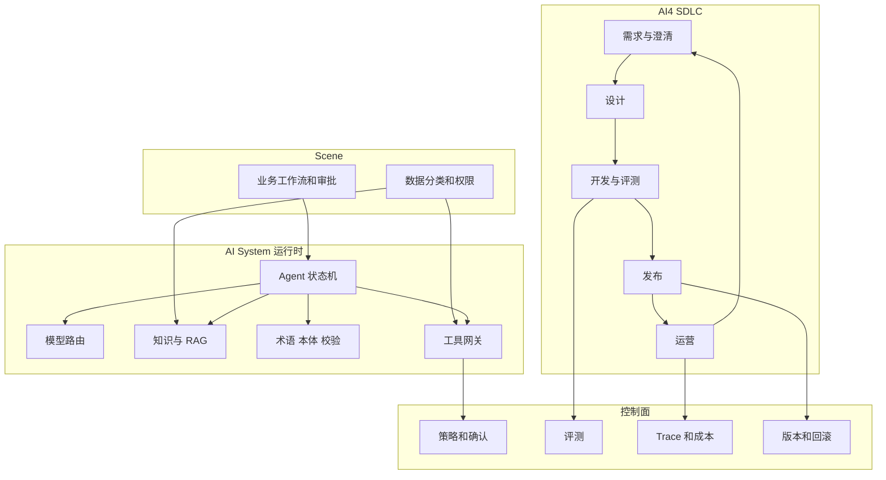

# 第 1 章：AI4D 总览

本章给出 AI4D 的定义、边界、角色、产物和参考架构。各层的做法、技巧和工具对照在后续章节展开。标号 ① 指的就是这套架构：第 4.7 节 Agent Architect 是它在运行时的落地，不是另一套设计。

## 1.1 AI4D 解决什么问题

AI4D（AI for Development）描述如何把模型、知识、工具和人放进同一条软件交付链路。交付对象是一个能在业务边界内完成任务、拿出证据、接受评测、留下动作记录并持续运行的系统。

单独一个能写代码或能回答问题的模型，还不构成 AI4D。系统还要回答五件事：

1. 这个能力服务于哪一个业务场景，成功和失败怎么衡量。
2. 模型看到的上下文从哪来，过期和越权的内容如何被挡住。
3. 模型可以调用哪些工具，哪些动作必须等人确认。
4. 代码、Prompt、模型、知识和索引改了之后，如何一起发布和回滚。
5. 线上回答错了、工具打错了，谁能沿 Trace 查到原因。

AI4D 有两条线，中间用 Scene 接上。

| 线 | 管什么 | 典型产物 |
| --- | --- | --- |
| AI4 SDLC | 需求、澄清、设计、开发、部署、运营怎么做 | 问题陈述、ADR、测试、发布单、事故复盘 |
| AI System | 模型、知识、检索、工具、策略、观测怎么组合 | 工具契约、索引、评测集、Trace |
| Scene | Agent 进入哪段业务流程，读哪些数据，何时停 | 状态、介入点、审批点、数据边界 |

## 1.2 和相邻工程的分工

AI4D 不替换现有职能，它规定这些职能在引入生成式模型之后多承担什么。

| 已有工程 | 继续负责 | 在 AI4D 里追加的责任 |
| --- | --- | --- |
| 软件开发 | 需求、设计、实现、测试、发布 | 把生成代码当成待审查变更；把 Prompt、评测和工具 Schema 当成代码资产 |
| 数据工程 | 数据质量、权限、管道、保留期 | 为检索提供可引用、可删除、可按租户过滤的知识，而不是只提供一张宽表 |
| 机器学习工程 | 训练、特征、模型版本、离线指标 | 当检索和 Prompt 已经不够时才进入微调；线上质量用任务成功率，不只用训练损失 |
| 运维与 SRE | 可用性、容量、事故、变更 | 把模型质量、检索命中、工具失败和 Token 成本纳入同一套事件处理 |

判断一个需求该不该进 AI4D，先看任务里有没有不稳定的语言理解和开放判断。步骤固定、输入输出稳定的流程，用普通服务和工作流引擎。错误成本高、又缺少验收样本的任务，先做辅助，不做成自动执行。

## 1.3 角色只锚定责任

角色说明“谁签字”，不说明“这一阶段怎么用 AI”。具体技巧在第 2 章。下面这些决定不能交给模型代签。

| 角色 | 签字的决定 | 模型可以起草、人必须改完再签 |
| --- | --- | --- |
| Product Owner | 目标、范围、优先级、验收是否算通过 | 用户故事、验收草稿、竞品摘要 |
| Solution Architect | 上下文边界、工具权限、失败时谁接管、ADR | 架构图、威胁清单、方案比较草稿 |
| 前端 / 后端开发 | 合并进主干的代码和接口契约 | 实现、测试、重构建议 |
| AI / Agent 工程师 | 工具 Schema、模型路由、评测门槛、知识更新方式 | Prompt、索引配置、评测脚本 |
| OPS | 放行、告警阈值、事故等级、回滚是否执行 | 告警摘要、相似案例、升级包草稿 |

同一个人可以兼两个角色。兼任不能取消评测和审查。写工具的人不能同时是该工具上线的唯一批准人。

## 1.4 方法论

### 从业务结果倒推能力

先写业务结果，再决定要不要模型、RAG、本体或自动执行。一个能往下做的问题至少包含：目标用户、触发事件、当前做法、期望结果、错误成本、数据来源、允许的动作、验收方式。缺任何一项，设计阶段只能产出待确认问题，不能产出实现任务。

### 用风险决定自主性

| 等级 | 系统做什么 | 上线前必须有的控制 |
| --- | --- | --- |
| 只读问答 | 基于允许的资料回答，并给出处 | 权限过滤、引用、无依据时拒答 |
| 建议 | 给出方案或补丁，人不点确认就不生效 | 建议和证据分开存，人可以改 |
| 受控写入 | 调用已登记的写工具 | 身份、资源范围、幂等键、超时、审计 |
| 高影响动作 | 改权限、资金、删除、生产变更 | 二次确认或审批、成功条件、回滚或补偿 |

Prompt 里写“不要删除数据”不能代替授权系统。授权放在工具网关，模型只看到它被允许调用的工具。

### 用证据验收

评测分开看：事实是否成立、出处是否真对应、有没有越权、工具参数是否符合 Schema、动作是否做完、失败能不能恢复。回答通顺只说明语言质量，不说明任务完成。

### 把 AI 资产放进软件工程

除了代码，这些资产也要有所有者、版本、变更记录和回滚方法：

- 模型名和版本、路由策略
- Prompt 和系统指令
- 工具 Schema 和权限策略
- 知识文档和切分配置
- Embedding 模型名、维度和索引版本
- 评测集和评分规则
- 本体、术语表和 SHACL 形状

改了 Embedding 模型却沿用旧索引，检索结果没有意义。发布单要写明哪些资产必须一起变。

### 用运行数据推动下一轮需求

线上日志要能把一次请求连到模型、Prompt 版本、知识版本、检索片段、工具调用和最终动作。运营里确认过的失败，进入评测集或知识修订，而不是只改一句 Prompt。知识库中的 AIOps 笔记把这件事写成闭环：L3 的结论要回写监控、Runbook 和架构改进，并用后续事件检查是否生效。

## 1.5 参考架构

控制面不生成业务答案。它决定能不能调用、有没有评测通过、出了问题能否降级。执行面的模型不能绕过工具网关直接连生产库。

四层运行时能力和知识库里的本体姿态对应：

| 架构部件 | 本体姿态 | 没有本体时的最小替代 |
| --- | --- | --- |
| 工具和输出结构 | Contract | JSON Schema 或 MCP 工具描述 |
| 多跳资料定位 | Index | 元数据过滤加关键词/向量检索 |
| 输出能不能进下游 | Guardrail | 应用内校验和人工抽检 |
| 新说法能不能进正式知识 | Memory | 文档评审和版本发布 |

L0 到 L5 的升级条件见第 4.5 节。架构上先留接口，不要求第一天装推理机。

## 1.6 总体选型原则

先写约束，再看功能。约束包括：数据能否出域、许可证能否商用、团队语言、现有 CI、数据规模、恢复时间目标。功能更多的框架，对小团队可能只增加升级和调试成本。

模型客户端、检索器、重排器、向量库和观测组件，都经过项目自己的接口。业务代码不依赖某一个 SDK 的内部对象。

最小验证用五条真实样本，而不是供应商演示：

1. 一条有标准答案的业务问题。
2. 一条资料里没有答案的问题，期望拒答。
3. 一条越权问题，期望在检索前被过滤。
4. 一次工具超时或失败，期望可重试或转人工，且不重复提交副作用。
5. 一次模型和知识版本回滚，期望旧行为恢复。

记录准确性、引用是否对得上、延迟、成本、恢复时间和团队能否独立排障。

## 1.7 本章产物

1. 一页场景和边界：做什么、不做什么、错误成本、自主性等级。
2. AI 资产清单：资产、所有者、存放位置、回滚方式。
3. 选型记录：约束、候选、五条样本的结果。
4. 工程约定：Coding Agent 能改哪些目录、合并前跑哪些命令、哪些动作禁止自动执行。

## 1.8 本章和后文的关系

| 你要做的决定 | 去哪一章 |
| --- | --- |
| 某个阶段如何用 AI 写需求、设计和代码 | 第 2 章 |
| Agent 插进哪一步业务流程、数据放在哪 | 第 3 章 |
| 模型、知识、RAG、本体、向量库怎么选 | 第 4 章 |
| 上线和出事之后看什么 | 第 5 章 |
| 把上面串成一条订单履约例子 | 第 6 章 |
